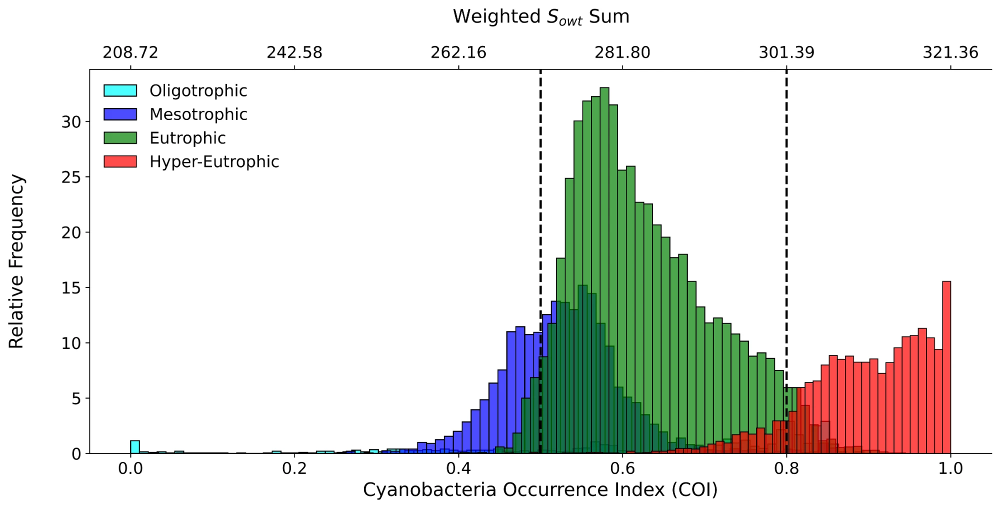
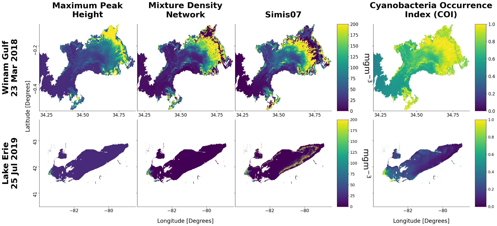

# COI: Cyanobacteria Occurrence Index

`coi` computes the **Cyanobacteria Occurrence Index (COI)** from satellite water reflectance.

Each pixel's spectrum is compared with a library of 25 reference Optical Water Types (OWTs) for inland waters. This gives one membership score (Sowt) per OWT. The scores are combined into a weighted sum (Wsum), and Wsum is rescaled to a 0–1 index (COI). By default, the package uses the extended 25-OWT library and the OWT weights from [Lomeo *et al.* (2025)](https://doi.org/10.1016/j.isprsjprs.2025.03.006).

Supported sensors: **OLCI**, **MERIS** and **MODIS**. You can also give your own list of bands.

You can use `coi` from the command line on netCDF files, or from Python on any `xarray.Dataset`. It processes pixels in blocks, so memory use stays low on large scenes. It also works with lazy, dask-backed datasets.

> [!IMPORTANT]
> The COI was developed with OLCI (Sentinel-3A/B) reflectance from the ESA Lake_cci v3 lake colour product, which is atmospherically corrected with **Polymer v4.17b**. The OWT library, the weights and the default Wsum range all come from that data. Reflectance from another atmospheric correction (or another sensor) may bias the COI, so use it with care.

**Contents:** [Method](#method) · [Results from the paper](#results-from-the-paper) · [Installation](#installation) · [Input data](#input-data) · [Command line](#command-line) · [Python](#python) · [Custom weights and reference files](#custom-weights-and-reference-files) · [Tests](#tests) · [Citation](#citation)

---

## Method


*How the OWT library, the OWT weights and the COI were derived. Figure from [Lomeo et al. (2025)](https://doi.org/10.1016/j.isprsjprs.2025.03.006), [CC BY 4.0](https://creativecommons.org/licenses/by/4.0/).*

The package ships the resulting 25-OWT library and weights, and applies the last two steps of the workflow. For each valid pixel, it does the following:

1. **Standardise.** Divide the pixel spectrum, and each reference OWT spectrum, by its area (trapezoidal integral over wavelength).
2. **Score.** Compute the spectral angle θ between the pixel and each OWT. The membership score is Sowt = 1 − θ/π, so 1 means an identical shape.
3. **Fractionality.** Compute each OWT's share of the total score: Pᵢ = Sowtᵢ^exp / Σⱼ Sowtⱼ^exp. The paper uses exp = 1, which is the default.
4. **Weighted sum.** Wsum = Σᵢ Sowtᵢ · wᵢ · Pᵢ, where wᵢ is the weight of OWT *i*.
5. **Index.** COI = (Wsum − min_wsum) / (max_wsum − min_wsum), clipped to [0, 1].

The default range (`min_wsum = 223`, `max_wsum = 321`) was derived for OLCI. For other sensors or band sets, you may want to set your own range.

## Results from the paper



*Distribution of COI (bottom axis) and the matching Wsum (top axis) by trophic state. Figure from [Lomeo et al. (2025)](https://doi.org/10.1016/j.isprsjprs.2025.03.006), [CC BY 4.0](https://creativecommons.org/licenses/by/4.0/).*



*COI compared with three algorithms from the literature (Maximum Peak Height, Mixture Density Network and Simis07) in Winam Gulf on 23 March 2018 and Lake Erie on 25 July 2019. Figure from [Lomeo et al. (2025)](https://doi.org/10.1016/j.isprsjprs.2025.03.006), [CC BY 4.0](https://creativecommons.org/licenses/by/4.0/).*

---

## Installation

`coi` needs Python 3.9 or newer. It installs numpy, pandas, xarray and netCDF4.

> **The repository is private.** You need read access to `davidelomeo/coi` on GitHub, and git needs to be able to sign in. Use one of these:
> - **HTTPS**: sign in once with the [GitHub CLI](https://cli.github.com/) (`gh auth login`, then `gh auth setup-git`). Then use the `https://` URLs below.
> - **SSH**: if you have an SSH key on GitHub, replace `git+https://github.com/` with `git+ssh://git@github.com/` in the commands below.

### pip

```bash
pip install "git+https://github.com/davidelomeo/coi.git"
```

To install with dask support (lazy and parallel processing of large files):

```bash
pip install "coi[dask] @ git+https://github.com/davidelomeo/coi.git"
```

### uv

To install into the current environment:

```bash
uv pip install "git+https://github.com/davidelomeo/coi.git"
```

To add it as a dependency of a uv project:

```bash
uv add "git+https://github.com/davidelomeo/coi.git"
```

### conda / mamba

Install the dependencies from conda-forge, then install `coi` itself with pip into the same environment:

```bash
conda create -n coi -c conda-forge python=3.12 numpy pandas xarray netcdf4 dask pip
```

```bash
conda activate coi
```

```bash
pip install "git+https://github.com/davidelomeo/coi.git"
```

### From a local clone (for development)

```bash
git clone https://github.com/davidelomeo/coi.git
```

```bash
cd coi && pip install -e ".[test]"
```

To check the installation:

```bash
coi --version
```

---

## Input data

The input is an `xarray.Dataset` (or a netCDF file) with **one variable per band**, named `Rw<wavelength>`, for example `Rw443`. Names with a `_mean` suffix, such as `Rw443_mean`, are also accepted.

- Band variables can have any dimensions (e.g. `(y, x)`, `(time, lat, lon)`), but they must all match.
- The input can be on any scale, for example `Rw` or `Rrs`. Each spectrum is standardised by its area before it is compared with the reference spectra, so a constant scale factor does not change the result.
- A pixel is returned as NaN if any of its bands is NaN or infinite, or if it falls outside the optional `valid_mask`.

### Sensors and bands

| Sensor | Bands used |
|---|---|
| `OLCI` | Rw412, Rw443, Rw490, Rw510, Rw560, Rw620, Rw665, Rw674, Rw681, Rw709, Rw754, Rw779 |
| `MERIS` | Same as OLCI, without Rw674 |
| `MODIS` | Rw412, Rw443, Rw488, Rw555, Rw667, Rw678, Rw748 |

The reference OWT library is defined on the 12 OLCI bands. For MODIS, each band is compared with the nearest OLCI reference band:

| MODIS | Rw412 | Rw443 | Rw488 | Rw555 | Rw667 | Rw678 | Rw748 |
|---|---|---|---|---|---|---|---|
| Reference (OLCI) | Rw412 | Rw443 | Rw490 | Rw560 | Rw665 | Rw681 | Rw754 |

Sensor names are case-insensitive. With **custom bands** (`bands=[...]` or `-b`), every band must be a row of the reference OWT table. For the default library, that means a subset of the 12 OLCI bands above.

---

## Command line

```bash
coi -i input.nc -o output.nc -s OLCI
```

| Option | Description | Default |
|---|---|---|
| `-i`, `--input` | Input netCDF file | required |
| `-o`, `--output` | Output netCDF file (folders are created if needed) | required |
| `-s`, `--sensor` | `OLCI`, `MERIS` or `MODIS` | one of `-s` / `-b` |
| `-b`, `--bands` | Comma-separated custom bands, e.g. `"Rw443,Rw490,Rw560"` | one of `-s` / `-b` |
| `--weights-file` | JSON file with custom OWT weights | packaged weights |
| `--owt-file` | CSV file with custom reference OWT spectra | packaged library |
| `--min-wsum` | Wsum mapped to COI = 0 | 223.0 |
| `--max-wsum` | Wsum mapped to COI = 1 | 321.0 |
| `--exp` | Exponent of the fractionality term | 1.0 |
| `--return-all` | Also write the input bands and every `sowt_*` score | off |
| `--version` | Print the version and exit | |

More examples:

```bash
# MODIS with a different Wsum range
coi -i input.nc -o output.nc -s MODIS --min-wsum 200 --max-wsum 300

# Custom bands
coi -i input.nc -o output.nc -b Rw443,Rw490,Rw560,Rw665,Rw681

# Custom weights and reference OWT library
coi -i input.nc -o output.nc -s OLCI --weights-file weights.json --owt-file reference_owt.csv

# Also keep the input bands and the OWT scores
coi -i input.nc -o output.nc -s MERIS --return-all
```

The output variables are compressed (zlib, level 5), and the file has a `processing_date` attribute. If anything fails, the error is logged and the command exits with status 1.

---

## Python

```python
import xarray as xr
from coi import COI

ds = xr.open_dataset("input.nc")

result = COI(ds, sensor="OLCI").process_spectral_data()
result.to_netcdf("output.nc")
```

`result` is an `xarray.Dataset` with the same coordinates as `ds` and two variables:

- `wsum`: weighted sum of the OWT membership scores
- `coi`: Cyanobacteria Occurrence Index, between 0 and 1

### Options

```python
import json
import pandas as pd
from coi import COI

with open("weights.json") as f:
    weights = json.load(f)
reference = pd.read_csv("reference_owt.csv", index_col=0)  # band names as the index

result = COI(
    ds,
    sensor="OLCI",             # or bands=["Rw443", "Rw490", ...] (give one, not both)
    w_owt=weights,             # default: packaged weights
    reference_owt=reference,   # default: packaged 25-OWT library
    min_wsum=223.0,            # Wsum mapped to COI = 0
    max_wsum=321.0,            # Wsum mapped to COI = 1
    exp=1.0,                   # exponent of the fractionality term
    valid_mask=ds["Rw443"] > 0,  # optional boolean DataArray; False -> NaN
    return_all=True,           # also return the input Rw* bands and every sowt_* score
).process_spectral_data()
```

With `return_all=True`, the result also contains every `Rw*` variable of the input and one `sowt_<OWT>` variable per reference OWT (for example `sowt_1.2`). Each `sowt_*` score is between 0 and 1, and 1 means the spectrum has exactly the shape of that OWT.

### Large files (dask)

If `dask` is installed, open the file in chunks. The calculation then stays lazy and runs chunk by chunk, in parallel, when the result is written or computed:

```python
ds = xr.open_dataset("big_scene.nc", chunks={"y": 2048, "x": 2048})
result = COI(ds, sensor="OLCI").process_spectral_data()  # lazy, nothing computed yet
result.to_netcdf("output.nc")                            # computed here
```

### Lower-level functions

The two steps of the method are also available on their own:

```python
from coi import compute_spectral_angle, calculate_wsum_and_coi

# spectra: numpy array of shape (n_pixels, n_bands), in the order of `bands`
scores = compute_spectral_angle(spectra, bands, reference_owt)  # (n_pixels, n_owt), 1 - angle/pi

# ds_scores: Dataset with one 'sowt_<OWT>' variable per OWT
ds_scores = calculate_wsum_and_coi(ds_scores, w_owt, min_wsum=223.0, max_wsum=321.0, exp=1.0)
```

---

## Custom weights and reference files

**Reference OWT library (CSV).** The first column holds the band names (`Rw412`, `Rw443`, …) and there is one column per OWT, named `OWT_<name>`:

```text
wl,OWT_1.2,OWT_4.2,...,OWT_13
Rw412,0.0691,0.0365,...,0.3710
Rw443,0.0415,0.0542,...,0.3147
...
```

**Weights (JSON).** There is one entry per OWT, keyed `sowt_<name>`. The names must match the `OWT_<name>` columns of the reference library:

```json
{"sowt_1.2": 1000, "sowt_4.2": 0, "sowt_6.2": 100, "...": "...", "sowt_13": 0}
```

The packaged files are in [`coi/core_files/`](coi/core_files): `OWT_inland_mean_standardised_extended.csv` and `w_owt.json`.

---

## Tests

```bash
pip install -e ".[test]"
```

```bash
pytest
```

The tests run automatically on GitHub Actions with Python 3.9 and 3.13.

---

## Citation

If you use this package, please cite the paper that describes the method:

> Lomeo, D., Simis, S. G. H., Liu, X., Selmes, N., Warren, M. A., Jungblut, A. D., & Tebbs, E. J. (2025). A novel cyanobacteria occurrence index derived from optical water types in a tropical lake. *ISPRS Journal of Photogrammetry and Remote Sensing*, 223, 58–77. https://doi.org/10.1016/j.isprsjprs.2025.03.006

```bibtex
@article{lomeo2025coi,
  title   = {A novel cyanobacteria occurrence index derived from optical water types in a tropical lake},
  author  = {Lomeo, Davide and Simis, Stefan G. H. and Liu, Xiaohan and Selmes, Nick and Warren, Mark A. and Jungblut, Anne D. and Tebbs, Emma J.},
  journal = {ISPRS Journal of Photogrammetry and Remote Sensing},
  volume  = {223},
  pages   = {58--77},
  year    = {2025},
  doi     = {10.1016/j.isprsjprs.2025.03.006}
}
```

## License

The code is released under the MIT license. See [LICENSE](LICENSE).

The figures in [`docs/figures/`](docs/figures) are from Lomeo *et al.* (2025) and are licensed under [CC BY 4.0](https://creativecommons.org/licenses/by/4.0/).
